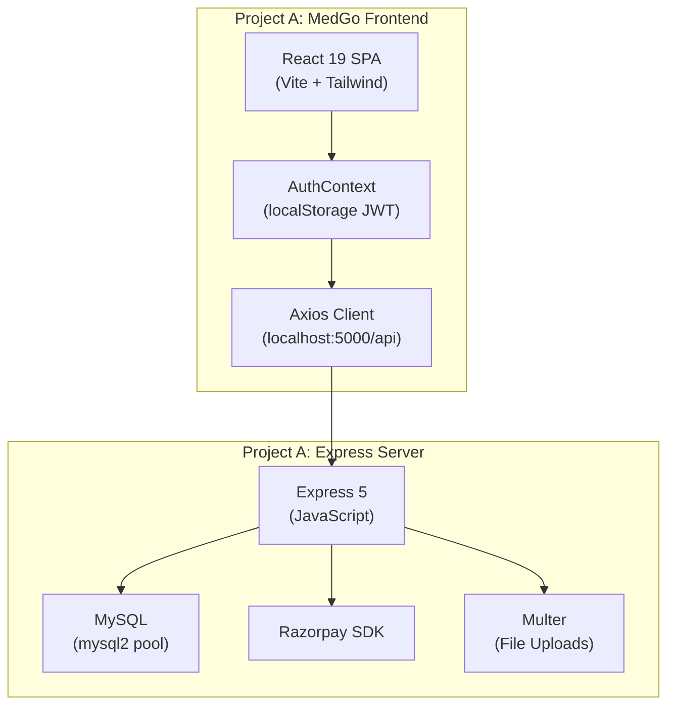
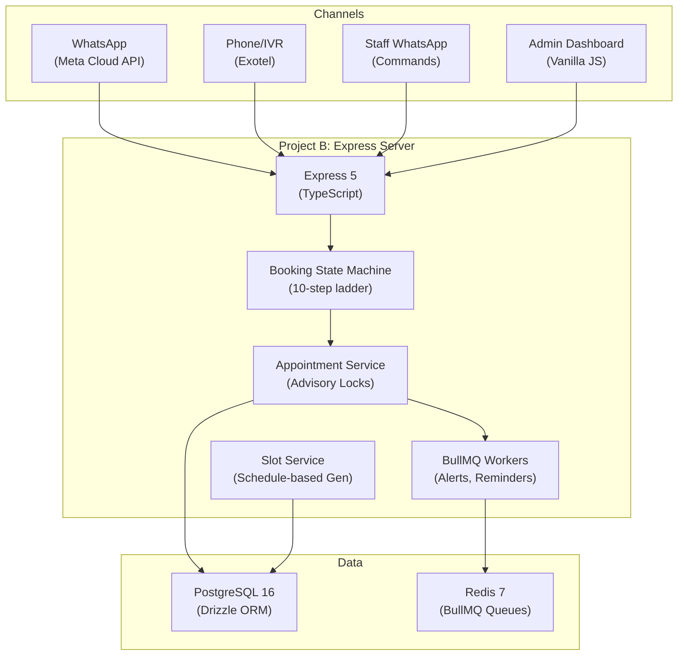
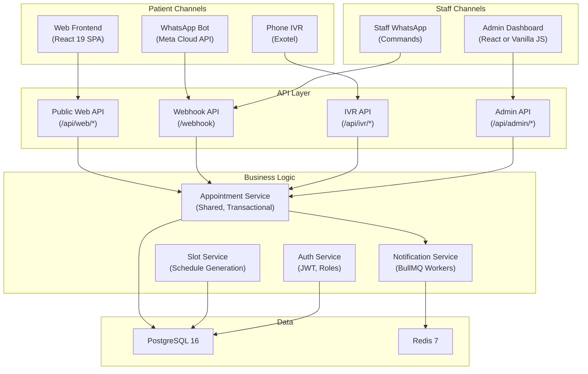
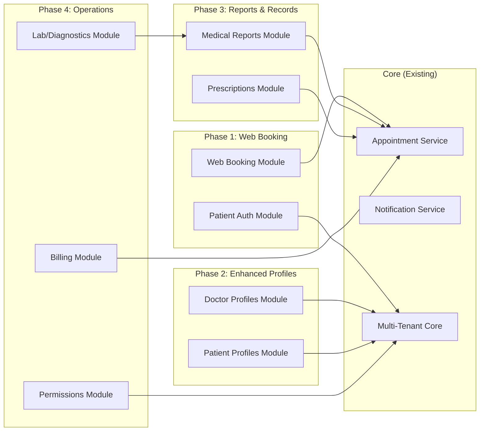

# Web Frontend Integration Analysis

## Integrating Appointment-Booking Frontend with WhatsApp Appointment Platform

**Date:** 2026-10-12
**Status:** Analysis & Planning (Read-Only)
**Author:** Architecture Analysis

---

## 1. Executive Summary

This report analyzes the integration of a **React 19 appointment-booking frontend** (Project A, branded "MedGo/CareSlot") with an existing **multi-tenant WhatsApp appointment platform** (Project B). The goal is to add a web-based patient booking channel alongside the existing WhatsApp and IVR channels, using a shared backend and database.

### Key Findings

| Dimension | Project A (Frontend) | Project B (WhatsApp Platform) |
|---|---|---|
| **Language** | JavaScript (React + Node) | TypeScript (Express + Node) |
| **Frontend** | React 19, Vite 8, Tailwind CSS 3 | Vanilla JS admin dashboard |
| **Backend** | Express 5, MySQL, raw SQL | Express 5, PostgreSQL, Drizzle ORM |
| **Auth** | JWT Bearer via localStorage | JWT Bearer + HTTP-only cookie |
| **IDs** | Auto-increment integers | UUIDs |
| **Tenancy** | Single-tenant | Multi-tenant (clinic isolation) |
| **Booking** | Seat-number with Razorpay payment | Token-number, no payment integration |
| **Slots** | Manual doctor-created slots | Auto-generated from weekly schedules |
| **Concurrency** | MySQL `FOR UPDATE` row locks | PostgreSQL advisory locks + `FOR UPDATE` |

### Recommendation

**Option B: Extract reusable UI components from Project A and rebuild the application shell to integrate with Project B's backend.**

Project A's frontend has excellent, production-quality UI components (doctor listing, slot picker, booking confirmation, doctor dashboard, admin panel). However, fundamental architectural differences (single-tenant vs multi-tenant, MySQL vs PostgreSQL, integer IDs vs UUIDs, seat-based vs token-based booking) mean the API layer and data models must be substantially rewritten. Extracting the visual components and rebuilding the API integration from scratch is cleaner and lower-risk than attempting to patch the existing frontend in place.

> [!IMPORTANT]
> Project B's backend is the **authoritative system**. All new web endpoints must be added to Project B. Project A's Express server should NOT be adopted or merged.

---

## 2. Current Architecture of Both Projects

### 2.1 Project A: Appointment-Booking Frontend

**Verified** — All details confirmed by source code inspection.

**Stack:**
- **Frontend:** React 19.2.7, Vite 8.1.1, React Router 7.18.1, Tailwind CSS 3.4.19, Axios 1.18.1, Lucide React icons
- **Backend:** Express 5.2.1, MySQL via mysql2, JWT (jsonwebtoken), bcrypt, Multer (file uploads), Razorpay SDK, Nodemailer
- **Database:** MySQL (connection pool via `mysql2`)

**Directory Structure:**
```
Appointment-Booking/
├── client/                          # React SPA
│   ├── src/
│   │   ├── App.jsx                  # Route definitions
│   │   ├── api/axios.js             # Axios client (baseURL: localhost:5000/api)
│   │   ├── context/
│   │   │   ├── AuthContext.jsx      # JWT + user state in localStorage
│   │   │   └── ToastContext.jsx     # Toast notifications
│   │   ├── components/
│   │   │   ├── Navbar.jsx           # Header with auth controls
│   │   │   ├── ProtectedRoute.jsx   # Role + approval_status guard
│   │   │   ├── LoginModal.jsx       # In-page auth popup
│   │   │   └── ...                  # Carousel, ticker, counter components
│   │   └── pages/
│   │       ├── Landing.jsx          # Mega homepage (1500+ lines)
│   │       ├── Login.jsx / Signup.jsx
│   │       ├── CategoryDoctors.jsx  # Specialty filter page
│   │       ├── patient/
│   │       │   ├── Dashboard.jsx    # Doctor directory with search & filters
│   │       │   └── DoctorProfile.jsx # Full profile + slot picker + booking
│   │       ├── doctor/
│   │       │   └── Dashboard.jsx    # Doctor portal (5 tabs)
│   │       └── admin/
│   │           ├── Login.jsx        # Admin login
│   │           └── Dashboard.jsx    # Approval + analytics + bookings
│   ├── tailwind.config.js           # Custom theme (MedGo green palette)
│   └── package.json
└── server/                          # Express API (NOT to be reused)
    ├── index.js                     # Entry point, seeds specializations
    ├── config/db.js                 # MySQL pool
    ├── controllers/                 # Auth, booking, doctor, slot, payment, admin
    ├── routes/                      # Route definitions
    └── middleware/authMiddleware.js  # JWT verify + role check
```

**Routes ([App.jsx](file:///D:/Projects/himu-frontend/Appointment-Booking/client/src/App.jsx)):**

| Path | Component | Auth |
|---|---|---|
| `/` | `Landing` | Public |
| `/login` | `Login` | Public |
| `/signup` | `Signup` | Public |
| `/doctors` | `patient/Dashboard` | Public |
| `/category/:categoryName` | `CategoryDoctors` | Public |
| `/health/:articleSlug` | `HealthArticle` | Public |
| `/doctor/setup-profile` | `DoctorProfileSetup` | Doctor |
| `/doctor/dashboard` | `doctor/Dashboard` | Doctor (approved) |
| `/admin/login` | `admin/Login` | Public |
| `/admin/dashboard` | `admin/Dashboard` | Admin |

**Verified:** Authentication uses JWT Bearer tokens stored in `localStorage`. The `AuthContext` provides `login()`, `logout()`, and `updateUser()`. Tokens are auto-attached via Axios interceptor ([axios.js](file:///D:/Projects/himu-frontend/Appointment-Booking/client/src/api/axios.js)).

---

### 2.2 Project B: WhatsApp Appointment Platform

**Verified** — All details confirmed by source code inspection.

**Stack:**
- **Backend:** Express 5.2.1 (TypeScript, ES Modules), PostgreSQL 16, Drizzle ORM 0.45.2, BullMQ 5.80.2, Redis 7, Zod 4.4.3
- **Auth:** JWT via `jose` library, bcryptjs, HTTP-only cookies + Bearer header
- **Integrations:** Meta WhatsApp Cloud API, Exotel IVR, SMS
- **Frontend:** Vanilla JS single-page admin dashboard (`public/admin/index.html`)
- **Infrastructure:** Docker Compose (PostgreSQL + Redis)

**Directory Structure:**
```
whatsapp-appointment-platform/
├── src/
│   ├── app.ts                       # Express setup, middleware, route mounting
│   ├── index.ts                     # Server bootstrap, worker init, shutdown
│   ├── components/
│   │   ├── admin/                   # Auth, tenant provisioning, session
│   │   ├── appointments/            # CRUD, dashboard, queue, cancel
│   │   ├── booking/                 # WhatsApp booking state machine
│   │   ├── doctors/                 # Profiles, schedules, slot management
│   │   ├── slots/                   # Generation algorithms, availability
│   │   ├── ivr/                     # Exotel voice IVR flows
│   │   ├── notifications/           # BullMQ alerts + daily summaries
│   │   ├── qr/                      # Clinic QR codes + standee posters
│   │   ├── reports/                 # Patient medical PDF delivery
│   │   ├── staff/                   # WhatsApp staff command parser
│   │   └── whatsapp/                # Webhook, inbound router, senders
│   ├── lib/
│   │   ├── db/                      # Postgres pool, Drizzle instance, models
│   │   ├── bull/                    # BullMQ queue factory + workers
│   │   ├── env.ts, jwt.ts, mutex.ts, retry.ts, logger.ts
│   │   └── errors.ts               # Custom error classes
│   ├── middlewares/                 # Admin JWT auth, error handler
│   └── scripts/                     # Maintenance scripts
├── public/admin/index.html          # Admin SPA
├── compose.yml                      # Docker: PostgreSQL + Redis
└── drizzle.config.ts                # Drizzle migration config
```

**API Route Mounts ([app.ts](file:///D:/Projects/whatsapp-appointment-platform/src/app.ts)):**

| Mount | Router | Auth |
|---|---|---|
| `/health` | Health check | Public |
| `/webhook` | WhatsApp webhook (GET/POST) | Meta HMAC signature |
| `/api/admin/*` | Admin auth, tenants | Admin JWT |
| `/api/appointments/*` | Dashboard, queue, status | Admin JWT |
| `/api/doctors/*` | Profiles, schedules, slots | Mixed (Admin + Public) |
| `/qr/*` | QR codes, standee posters | Public |
| `/api/ivr/*` | Exotel voice IVR flows | Exotel IP allowlist |

---

### 2.3 Architecture Diagrams

#### Project A Architecture



#### Project B Architecture



#### Proposed Integrated Architecture



---

## 3. Frontend Reuse Analysis

### 3.1 Component Reusability Assessment

| Component | File | Reusability | Notes |
|---|---|---|---|
| **Doctor Catalog & Search** | [`patient/Dashboard.jsx`](file:///D:/Projects/himu-frontend/Appointment-Booking/client/src/pages/patient/Dashboard.jsx) | ✅ Reusable with API changes | Excellent search, filter, sort, pagination UI. Replace API calls and adapt data model (UUIDs, tenant-scoped). |
| **Doctor Profile + Booking** | [`patient/DoctorProfile.jsx`](file:///D:/Projects/himu-frontend/Appointment-Booking/client/src/pages/patient/DoctorProfile.jsx) | ✅ Reusable with API changes | Date slider, slot picker, booking modal are excellent. Replace seat-number with token-number. Remove Razorpay (or add to Project B). |
| **Doctor Dashboard** | [`doctor/Dashboard.jsx`](file:///D:/Projects/himu-frontend/Appointment-Booking/client/src/pages/doctor/Dashboard.jsx) | ⚠️ Needs significant modification | 5-tab portal is well-designed. Slot creation model differs fundamentally (Project A: manual ranges; Project B: weekly schedule auto-generation). Needs redesign of slot tab. |
| **Doctor Onboarding** | [`DoctorProfileSetup.jsx`](file:///D:/Projects/himu-frontend/Appointment-Booking/client/src/pages/DoctorProfileSetup.jsx) | ⚠️ Needs significant modification | Project B doctors are provisioned by super_admin during tenant creation, not self-onboarded. This wizard doesn't fit the current model. May be useful for future doctor self-registration. |
| **Admin Dashboard** | [`admin/Dashboard.jsx`](file:///D:/Projects/himu-frontend/Appointment-Booking/client/src/pages/admin/Dashboard.jsx) | ✅ Reusable with API changes | Analytics, booking list, approval cards. Project B already has a Vanilla JS admin dashboard with similar features. Could replace it for a richer experience. |
| **Login / Signup Forms** | [`Login.jsx`](file:///D:/Projects/himu-frontend/Appointment-Booking/client/src/pages/Login.jsx), [`Signup.jsx`](file:///D:/Projects/himu-frontend/Appointment-Booking/client/src/pages/Signup.jsx) | ✅ Reusable with API changes | Clean form design. Auth flow needs adaptation for Project B's admin auth or new patient web auth. |
| **Login Modal** | [`LoginModal.jsx`](file:///D:/Projects/himu-frontend/Appointment-Booking/client/src/components/LoginModal.jsx) | ✅ Directly reusable | Standalone popup for in-flow authentication. Minimal API coupling. |
| **Navbar** | [`Navbar.jsx`](file:///D:/Projects/himu-frontend/Appointment-Booking/client/src/components/Navbar.jsx) | ✅ Reusable with minor changes | Auth state integration and link structure need updating. |
| **Landing Page** | [`Landing.jsx`](file:///D:/Projects/himu-frontend/Appointment-Booking/client/src/pages/Landing.jsx) | ⚠️ Needs significant modification | 1500+ line monolith mixing marketing, search, and booking. Better to extract reusable sub-sections. |
| **Category Doctors** | [`CategoryDoctors.jsx`](file:///D:/Projects/himu-frontend/Appointment-Booking/client/src/pages/CategoryDoctors.jsx) | ✅ Reusable with API changes | Specialty-filtered doctor listing with inline booking drawer. |
| **Tailwind Theme** | [`tailwind.config.js`](file:///D:/Projects/himu-frontend/Appointment-Booking/client/tailwind.config.js) | ✅ Directly reusable | Custom color palette, typography, animations. Forms the design system. |
| **AuthContext** | [`AuthContext.jsx`](file:///D:/Projects/himu-frontend/Appointment-Booking/client/src/context/AuthContext.jsx) | ✅ Reusable with minor changes | Pattern is clean. Need to adapt token storage strategy (consider HTTP-only cookies). |
| **ProtectedRoute** | [`ProtectedRoute.jsx`](file:///D:/Projects/himu-frontend/Appointment-Booking/client/src/components/ProtectedRoute.jsx) | ✅ Reusable with minor changes | Role guard pattern works. Approval_status check may not apply if doctors don't self-register. |
| **Carousel Components** | `AvailableTodayCarousel.jsx`, `OfferCarousel.jsx` | ✅ Directly reusable | Pure UI, no backend coupling. |
| **Health Articles** | [`HealthArticle.jsx`](file:///D:/Projects/himu-frontend/Appointment-Booking/client/src/pages/HealthArticle.jsx) | ❌ Not relevant | Static content, not related to appointment booking. |

### 3.2 Design Assets Reusable As-Is
- **Verified:** Tailwind config with MedGo color palette (`primary: #0F6E63`, `primary-dark: #0B5A50`, etc.)
- **Verified:** Sora + Inter typography configuration
- **Verified:** Custom animations (`fadeInUp`, `scale-in`, `marquee`)
- **Verified:** Public images (doctor portraits, health banners, service icons, logos) in `client/public/images/`
- **Verified:** SVG icon sprite in `client/public/icons.svg`

---

## 4. Backend Capability Inventory

### 4.1 Project B Existing Capabilities

| Capability | Status | Evidence |
|---|---|---|
| Multi-tenant clinic isolation | **Verified** | `tenants` table with UUID PK; all queries scoped by `tenantId` |
| Doctor profile management | **Verified** | `doctors` table + `users` table; CRUD via admin provisioning |
| Weekly schedule management | **Verified** | `PUT /api/doctors/:doctorId/schedule`; auto-regenerates slots |
| Slot generation from schedule | **Verified** | `generateSlots()` in `src/components/slots/services/generate-slots.ts` |
| Custom slot CRUD | **Verified** | `POST/PATCH/DELETE /api/doctors/:doctorId/slots` |
| Date blocking (leave/holiday) | **Verified** | `blocked_dates` table; auto-cancels affected appointments |
| Appointment creation (transactional) | **Verified** | `createAppointmentFromBooking()` with `pg_advisory_xact_lock` + `FOR UPDATE` |
| Sequential token number generation | **Verified** | `coalesce(max(tokenNumber), 0) + 1` per doctor per date |
| Duplicate booking prevention | **Verified** | Advisory lock + slot capacity check within transaction |
| Appointment status management | **Verified** | `booked → completed / cancelled / noshow` via `PATCH /api/appointments/:id/status` |
| Slot release on cancellation | **Verified** | Slot status restored to `available` when appointment cancelled |
| WhatsApp booking conversation flow | **Verified** | 10-step state machine in `src/components/booking/steps/` |
| Staff command processing | **Verified** | `TODAY`, `DONE`, `NOSHOW`, `CANCEL`, `BLOCK`, `SLOT`, `REPORT` commands |
| Dashboard analytics | **Verified** | `GET /api/appointments/clinics/:tenantId/dashboard` |
| Live queue management | **Verified** | `GET /api/appointments/clinics/:tenantId/queue` |
| BullMQ appointment reminders | **Verified** | 24-hour advance WhatsApp template reminders |
| Doctor booking alerts | **Verified** | Instant WhatsApp notification to doctor on new booking |
| Daily morning summary | **Verified** | 8 AM repeatable BullMQ job per tenant |
| QR code generation | **Verified** | SVG/PNG QR codes + printable standee posters |
| IVR appointment booking | **Verified** | Exotel DTMF-based voice booking flow |
| Medical report delivery | **Verified** | `reports` table + BullMQ worker for WhatsApp PDF delivery |
| Message audit logging | **Verified** | `messages` table logs all inbound/outbound WhatsApp messages |
| Admin auth (super + clinic) | **Verified** | JWT + HTTP-only cookie; `super_admin` and `clinic_admin` roles |

### 4.2 Capabilities Missing from Project B (Required for Web Frontend)

| Capability | Status | Notes |
|---|---|---|
| **Patient web authentication** | **Missing** | Patients are currently identified by WhatsApp phone number only. No email/password auth exists for patients. |
| **Public doctor listing API** | **Missing** | `GET /api/doctors/clinics/:tenantId` exists but requires admin auth. No public searchable doctor catalog. |
| **Public slot availability API** | **Partially exists** | Slot queries exist but are internal service functions, not exposed as public REST endpoints. |
| **Web-initiated appointment booking** | **Missing** | `createAppointmentFromBooking()` exists as a reusable service but is only called from WhatsApp booking flow. No REST endpoint wraps it for web clients. |
| **Patient booking history API** | **Missing** | No endpoint for a patient to retrieve their own appointments. |
| **Patient self-registration** | **Missing** | Users are created during WhatsApp conversation or admin provisioning. |
| **Online payment integration** | **Missing** | Project B has no payment processing. Project A has Razorpay. |
| **Doctor self-onboarding** | **Missing** | Doctors are provisioned by super_admin. No self-registration flow. |
| **File upload (doctor documents)** | **Missing** | No Multer or file upload handling in Project B. |
| **Doctor approval workflow** | **Missing** | Doctors are directly created as active by admin. No pending/approved states. |

---

## 5. Frontend-to-Backend API Mapping

This maps every frontend feature to the existing backend capability, identifying gaps.

### 5.1 Patient-Facing Features

| Frontend Feature | Project A Endpoint | Project B Equivalent | Gap Analysis |
|---|---|---|---|
| **Doctor listing + search** | `GET /api/doctor/list?q=&city=&specialization=` | `GET /api/doctors/clinics/:tenantId` (admin-only) | **Proposed:** New public endpoint `GET /api/web/:tenantSlug/doctors` with search/filter params |
| **Specialization list** | `GET /api/doctor/specializations` | None (specialization is a text field on `doctors` table) | **Proposed:** New endpoint `GET /api/web/:tenantSlug/specializations` derived from distinct doctor specializations |
| **City list** | `GET /api/doctor/cities` | N/A (single-clinic tenants, no city field) | **Not needed** — tenant implies clinic location |
| **Doctor profile** | `GET /api/doctor/profile/:id` | No public endpoint | **Proposed:** New `GET /api/web/:tenantSlug/doctors/:doctorId` |
| **Available dates** | Derived from `GET /api/slots/doctor/:doctorId` | `listAvailableDates()` internal service | **Proposed:** New `GET /api/web/:tenantSlug/doctors/:doctorId/available-dates` |
| **Available slots for date** | Derived from `GET /api/slots/doctor/:doctorId` | `listAvailableSlots()` internal service | **Proposed:** New `GET /api/web/:tenantSlug/doctors/:doctorId/slots?date=YYYY-MM-DD` |
| **Book appointment** | `POST /api/bookings` (locks seat) | `createAppointmentFromBooking()` service | **Proposed:** New `POST /api/web/:tenantSlug/appointments` wrapping existing service |
| **Confirm cash payment** | `PUT /api/bookings/:id/confirm-cash` | N/A (no payment in Project B) | **Deferred** — payment integration is a separate phase |
| **Cancel booking** | `PUT /api/bookings/:id/cancel` | `PATCH /api/appointments/:id/status` (admin-only) | **Proposed:** New patient-facing cancel endpoint |
| **Patient booking history** | `GET /api/bookings/patient/:patientId` | None | **Proposed:** New `GET /api/web/:tenantSlug/my/appointments` |
| **Booking location/map** | `GET /api/bookings/:id/location` | N/A (no chamber coordinates in Project B) | **Deferred** — requires schema addition |
| **Patient signup** | `POST /api/auth/signup` | Users created during WhatsApp flow | **Proposed:** New `POST /api/web/:tenantSlug/auth/register` |
| **Patient login** | `POST /api/auth/login` | Admin-only auth | **Proposed:** New `POST /api/web/:tenantSlug/auth/login` |

### 5.2 Data Model Mapping

| Project A Field | Project A Type | Project B Equivalent | Transformation |
|---|---|---|---|
| `user.id` | INT auto-increment | `users.id` | UUID |
| `doctor_profiles.id` | INT | `doctors.id` | UUID |
| `doctor_slots.id` | INT | `slots.id` | UUID |
| `slot_bookings.id` | INT | `appointments.id` | UUID |
| `seat_number` | INT | `tokenNumber` | Conceptually equivalent (patient queue position) |
| `booking_status` | `pending/confirmed/cancelled` | `status`: `booked/completed/cancelled/noshow` | Map `confirmed → booked`, add `completed` and `noshow` |
| `payment_status` | `pending/paid` | N/A | Not in Project B |
| `payment_method` | `online/cash` | N/A | Not in Project B |
| `approval_status` | `pending/approved/rejected` | N/A (doctors always active) | Not in Project B |
| `consultation_fee` | DECIMAL | N/A (not on doctors table) | **Proposed:** Add to `doctors` table |
| `chamber_address` / `city` | VARCHAR | N/A | **Proposed:** Add clinic/location fields |
| `profile_image` | VARCHAR (file path) | N/A | **Proposed:** Add to `doctors` table |
| `rating_avg` / `total_reviews` | DECIMAL/INT | N/A | **Proposed:** Future feature |
| `specialization_id` → FK | INT FK to `specializations` | `doctors.specialization` (text) | Text field, no FK |
| N/A | N/A | `tenantId` | All queries must be tenant-scoped |

### 5.3 Response Format Differences

**Project A doctor listing response:**
```json
{
  "id": 1,
  "name": "Dr. Smith",
  "specialization": "Cardiology",
  "consultation_fee": 500,
  "chamber_address": "123 Main St",
  "city": "Guwahati",
  "rating_avg": 4.5,
  "total_reviews": 12,
  "profile_image": "uploads/profiles/dr_smith.jpg",
  "qualification": "MBBS, MD"
}
```

**Project B doctor listing response (current admin endpoint):**
```json
{
  "id": "a1b2c3d4-...",
  "userId": "e5f6g7h8-...",
  "tenantId": "t1u2v3w4-...",
  "specialization": "Cardiology",
  "consultationDurationMinutes": 15,
  "isActive": true
}
```

> [!WARNING]
> The frontend expects `name`, `consultation_fee`, `chamber_address`, `city`, `rating_avg`, `profile_image`, and `qualification` — none of which exist in Project B's `doctors` table. The new public API endpoints must join `doctors` with `users` (for name) and include any added fields.

---

## 6. Appointment Business Logic & Data-Flow Analysis

### 6.1 Current Booking Flow Comparison

**Project A Booking Flow (Web):**
1. Patient browses doctor list → selects doctor → views profile page
2. Selects date → time slot pill → clicks "Book Appointment"
3. If not logged in → `LoginModal` appears for in-flow auth
4. `POST /bookings` → MySQL transaction with `FOR UPDATE` on slot → assigns `seat_number` = `MAX(seat_number) + 1` → booking status `pending`
5. Option A: Razorpay checkout → `POST /payments/create-order` → `POST /payments/verify` → status `confirmed`
6. Option B: "Pay at Clinic" → `PUT /bookings/:id/confirm-cash` → status `confirmed`
7. Confirmation screen with chamber location map

**Project B Booking Flow (WhatsApp):**
1. Patient sends message to clinic WhatsApp number
2. Webhook receives message → resolves tenant by `whatsapp_phone_number_id`
3. 10-step state machine: `idle` → `select_language` → `select_action` → `select_doctor` → `select_date` → `select_slot` → `enter_name` → `enter_age` → `enter_complaint` → `confirm_booking`
4. On confirmation: `createAppointmentFromBooking()` → PostgreSQL transaction with `pg_advisory_xact_lock` + `FOR UPDATE` on slot → assigns `tokenNumber` = `coalesce(max(tokenNumber), 0) + 1` → status `booked`
5. Schedules reminder (BullMQ, 24h before) + booking alert to doctor
6. Sends confirmation message with token number

### 6.2 Shared Business Logic Assessment

**Verified:** The core booking operation `createAppointmentFromBooking()` in [`src/components/appointments/services/create-appointment.ts`](file:///D:/Projects/whatsapp-appointment-platform/src/components/appointments/services/create-appointment.ts) is already **cleanly isolated as a reusable service function**. It:

1. Accepts a `CreateAppointmentParams` object (no channel-specific dependencies)
2. Runs inside a Drizzle transaction
3. Acquires advisory lock on `doctorId:appointmentDate`
4. Locks slot row with `FOR UPDATE`
5. Validates slot availability and capacity
6. Computes sequential token number
7. Inserts appointment record
8. Returns the created appointment or `null`

This is the ideal integration point. A new web booking endpoint simply needs to:
1. Authenticate the web patient
2. Validate input (Zod schema)
3. Call `createAppointmentFromBooking()` with the same params
4. Schedule notifications (same as WhatsApp flow does)
5. Return the appointment + token to the frontend

**Verified:** Notification scheduling (`scheduleReminder` + `scheduleBookingAlert`) is also cleanly separated and can be called from any channel.

### 6.3 Concurrency & Conflict Prevention

| Mechanism | Project A | Project B |
|---|---|---|
| Transaction isolation | MySQL `BEGIN` + `FOR UPDATE` | PostgreSQL `db.transaction()` + `FOR UPDATE` |
| Cross-request lock | Row-level only | `pg_advisory_xact_lock` + row-level |
| Capacity check | `seats_booked >= capacity` | `count(booked appointments) >= maxPatients` |
| Token/seat assignment | `MAX(seat_number) + 1` | `coalesce(max(tokenNumber), 0) + 1` |
| Atomic guarantee | Yes (MySQL transaction) | Yes (PostgreSQL transaction + advisory lock) |

**Verified:** Project B's concurrency model is more robust (advisory locks prevent phantom reads across concurrent transactions). The web frontend can safely rely on Project B's existing locking mechanism.

---

## 7. Database & Data Ownership Analysis

### 7.1 Source of Truth

> [!IMPORTANT]
> **Project B's PostgreSQL database is the authoritative system.** All appointment, doctor, slot, and patient data must live in Project B's database. Project A's MySQL database should NOT be used in the integrated system.

### 7.2 Schema Comparison

| Entity | Project A (MySQL) | Project B (PostgreSQL) | Assessment |
|---|---|---|---|
| **Users/Patients** | `users` (id INT, name, email, phone, password_hash, role) | `users` (id UUID, tenantId FK, phoneNumber, role, name, languagePreference) | Project B lacks email, password_hash. **Schema extension needed.** |
| **Doctors** | `doctor_profiles` (id INT, user_id FK, specialization_id FK, qualification, experience, fee, address, city, lat, lng, about, image, approval_status, rating) | `doctors` (id UUID, tenantId FK, userId FK, specialization TEXT, consultationDurationMinutes, isActive) | Project B has minimal doctor profile. **Schema extension needed.** |
| **Specializations** | `specializations` (id INT, name) — 16 seeded | None (text field on doctors) | **Proposed:** Optional lookup table or keep as text. |
| **Slots** | `doctor_slots` (id INT, doctor_id, slot_date, start_time, end_time, capacity, seats_booked, is_video_consult, status) | `slots` (id UUID, tenantId, doctorId, slotDate, dayOfWeek, startTime, endTime, status, maxPatients) | Similar structure. Project B's `status` enum: `available/booked/blocked/cancelled` vs Project A's `open/closed`. |
| **Appointments/Bookings** | `slot_bookings` (id INT, slot_id, patient_id, seat_number, booking_status, payment_status, payment_method) | `appointments` (id UUID, tenantId, doctorId, patientId, slotId, tokenNumber, appointmentDate, appointmentTime, patientName, patientAge, complaint, status, cancelReason, reminderSent) | Project B is richer (patient details, complaint, reminder tracking). Project A has payment fields. |
| **Payments** | `payments` (id INT, booking_id, amount, currency, gateway, transaction_id, status, paid_at) | None | **Proposed:** Add payments table to Project B when payment integration is needed. |
| **Doctor Documents** | `doctor_documents` (id, doctor_id, document_type, file_path, status) | None | Not needed for initial integration. |
| **Blocked Dates** | None | `blocked_dates` (id UUID, tenantId, doctorId, blockedDate, reason, notes) | Project B has this; Project A doesn't. |
| **Reports** | None | `reports` (id UUID, tenantId, patientId, appointmentId, uploadedBy, fileUrl, caption, status, retryCount) | Project B already supports medical reports. |
| **Messages** | None | `messages` (direction, fromNumber, toNumber, waMessageId, body, rawPayload) | WhatsApp audit log. Not relevant to web frontend. |
| **Conversation State** | None | `conversation_state` (tenantId, phoneNumber, currentStep, tempData) | WhatsApp-only. Not relevant to web frontend. |
| **Tenants** | None | `tenants` (id UUID, name, whatsappPhoneNumberId, status, timezone, reminders/notifications config) | Multi-tenancy core. Web frontend must operate within tenant context. |
| **Admin Users** | Hardcoded admin role in `users` | `admin_users` (id UUID, email, passwordHash, name, role, tenantId, status) | Separate admin table in Project B. |

### 7.3 Required Schema Extensions for Web Integration

**Proposed additions to Project B's database (Drizzle migrations):**

1. **Extend `users` table:**
   - Add `email` (varchar, unique per tenant, nullable)
   - Add `passwordHash` (varchar, nullable — WhatsApp users won't have passwords)

2. **Extend `doctors` table:**
   - Add `qualification` (varchar, nullable)
   - Add `experienceYears` (integer, nullable)
   - Add `consultationFee` (decimal, nullable)
   - Add `chamberAddress` (text, nullable)
   - Add `about` (text, nullable)
   - Add `profileImageUrl` (varchar, nullable)

3. **Future: Add `payments` table** (when payment integration is needed)

> [!CAUTION]
> All schema changes must be additive (new nullable columns, new tables). Do NOT modify existing column types, remove columns, or change constraints. This preserves backward compatibility with the WhatsApp and IVR flows.

---

## 8. Authentication & Security Analysis

### 8.1 Current Auth Mechanisms

| Aspect | Project A | Project B |
|---|---|---|
| **Patient auth** | Email + password → JWT Bearer in localStorage | Phone number identification via WhatsApp (no auth) |
| **Doctor auth** | Same as patient (role-based) | No doctor auth (doctors interact via WhatsApp commands) |
| **Admin auth** | Same JWT, role `admin` | Separate `admin_users` table, JWT + HTTP-only cookie |
| **Token signing** | `jsonwebtoken` library, `JWT_SECRET` env var | `jose` library, `ACCESS_TOKEN_SECRET` env var |
| **Token expiry** | 7 days | Configurable via `ACCESS_TOKEN_EXPIRATION` |
| **Token transport** | `Authorization: Bearer` header only | Cookie `admin_token` OR `Authorization: Bearer` header |
| **Role model** | `patient / doctor / admin` | Users: `patient / doctor / receptionist`; Admins: `super_admin / clinic_admin` |

### 8.2 Recommended Auth Architecture for Web Frontend

**Proposed:** Create a new patient web authentication layer in Project B:

1. **Patient Registration:** `POST /api/web/:tenantSlug/auth/register`
   - Accepts `name, email, phone, password`
   - Creates `users` record with `role: 'patient'` and hashed password
   - Returns JWT token

2. **Patient Login:** `POST /api/web/:tenantSlug/auth/login`
   - Accepts `email + password` or `phone + password`
   - Returns JWT token with `{ userId, tenantId, role: 'patient' }`

3. **Token Transport:** HTTP-only secure cookie (preferred) OR Bearer header
   - HTTP-only cookie prevents XSS token theft
   - Bearer header supported for mobile app compatibility

4. **Middleware:** New `requirePatientAuth` middleware (separate from admin auth)
   - Verifies JWT using same `jose` library and `ACCESS_TOKEN_SECRET`
   - Attaches `req.patient = { id, tenantId }` to request

5. **Phone Deduplication:** If a patient registers via web with a phone number that already exists in `users` (from WhatsApp), link the accounts rather than creating a duplicate.

### 8.3 Security Considerations

| Risk | Mitigation |
|---|---|
| **Patient data isolation** | All queries scoped by `tenantId` AND `patientId`. A patient cannot access another patient's appointments. |
| **Cross-tenant access** | Tenant resolved from URL slug, validated against JWT's `tenantId`. |
| **CORS** | Project B already has CORS configured. Add web frontend origin to allowed list. |
| **CSRF** | If using HTTP-only cookies, implement CSRF token mechanism. |
| **Rate limiting** | Admin login already rate-limited. Add rate limiting to patient auth endpoints. |
| **Password security** | Use `bcryptjs` (already in Project B). Minimum 8 characters, complexity rules. |
| **Input validation** | Use Zod schemas (already the standard in Project B). |
| **Sensitive data** | Never return `passwordHash` in API responses. Mask phone numbers in public endpoints. |

---

## 9. Future HMS & Medical Reports Architecture

### 9.1 Existing Foundation for HMS

**Verified:** Project B already has several building blocks for HMS expansion:

| HMS Module | Current State | Foundation |
|---|---|---|
| **Patient Management** | Basic (name, phone, age) | `users` table + per-appointment patient data. Needs dedicated patient profile. |
| **Doctor Management** | Basic (specialization, duration) | `doctors` table. Needs enrichment (qualifications, fees, images). |
| **Appointment Scheduling** | Complete | Full transactional booking, token generation, queue management. |
| **Reception/Queue Management** | Complete | Live queue endpoint, status transitions (DONE/NOSHOW/CANCEL). |
| **Medical Reports** | Partial | `reports` table + WhatsApp delivery worker. Needs web access. |
| **Notifications** | Complete | BullMQ workers for reminders, alerts, daily summaries. |
| **Multi-Tenant/Clinic** | Complete | `tenants` table with full isolation. |
| **Admin & Roles** | Partial | `super_admin` + `clinic_admin`. Needs granular permissions. |
| **Audit Logging** | Partial | WhatsApp message logs. Needs general activity audit. |

### 9.2 Medical Reports Web Access

**Verified:** Project B has a `reports` table with fields: `id`, `tenantId`, `patientId`, `appointmentId`, `uploadedBy`, `fileUrl`, `caption`, `status`, `retryCount`.

**Proposed** web access flow:
1. Staff uploads report via admin dashboard → stored with `fileUrl`
2. Report linked to patient + appointment
3. Patient accesses via `GET /api/web/:tenantSlug/my/reports`
4. Serve via signed/time-limited URL or through authenticated download endpoint
5. Access logged for audit trail

### 9.3 Recommended Modular Architecture for HMS



> [!TIP]
> Each module should be a self-contained `src/components/<module>/` directory following Project B's existing pattern (routes, services, handlers). This preserves the clean modular architecture.

---

## 10. Integration Options Comparison

| Criterion | Option A: Replace API Layer | Option B: Extract UI + Rebuild Shell | Option C: Integrate into Existing Frontend | Option D: Full Rebuild |
|---|---|---|---|---|
| **Description** | Keep Project A's client app, swap all API calls to point at Project B | Extract reusable UI components, build new React app integrated with Project B | Add pages to Project B's vanilla JS admin dashboard | Build entirely new frontend from scratch |
| **Reusable code** | ~70% of frontend files | ~50% of components + 100% of design system | ~0% (different tech stack) | 0% |
| **Required modifications** | Every API call, data model, auth flow | New app shell, routing, auth context; reuse visual components | Rewrite everything in vanilla JS | Everything |
| **Architectural complexity** | Medium-High (fight data model mismatches) | Medium (clean integration surface) | High (vanilla JS limitations) | High (no reuse) |
| **Integration risk** | High (hidden coupling to old data models) | Low-Medium (explicit adaptation) | Low (same codebase) | Low (greenfield) |
| **Maintenance cost** | High (dual mental model) | Low-Medium (unified approach) | Low (single codebase) | Medium |
| **Backend compatibility** | Poor (constant field mapping) | Good (purpose-built API layer) | Excellent (same server) | Good |
| **Auth compatibility** | Needs significant rework | Purpose-built for Project B auth | Already integrated | Purpose-built |
| **Testing effort** | High (verify every adapted call) | Medium (test new integration points) | Medium | High |
| **HMS scalability** | Poor (single-tenant assumptions baked in) | Excellent (multi-tenant from start) | Limited (vanilla JS) | Excellent |
| **Time to first booking** | Medium | Medium | Short | Long |
| **Recommended?** | ❌ No | ✅ **Yes** | ❌ No | ❌ No |

### Recommendation: Option B

**Option B (Extract UI + Rebuild Shell)** is recommended because:

1. **Clean separation:** Avoids dragging Project A's single-tenant assumptions, integer IDs, MySQL coupling, and Razorpay payment flow into the new system.
2. **Reuses the best parts:** The visual design, component layouts, Tailwind theme, and UX patterns are excellent and transfer cleanly.
3. **Purpose-built integration:** API clients, data models, and auth are built specifically for Project B's multi-tenant PostgreSQL backend.
4. **HMS-ready:** The new frontend is designed from day one for multi-tenancy, tenant-scoped routing, and modular feature expansion.
5. **Lower risk:** Explicit adaptation is safer than implicit compatibility assumptions.

---

## 11. Recommended Target Architecture

### 11.1 System Overview

```
┌─────────────────────────────────────────────────────────────────┐
│                    Patient Web Application                       │
│         React 19 + Vite + Tailwind CSS (Project A design)       │
│    Routes: /:tenantSlug/doctors, /:tenantSlug/book/:doctorId    │
└──────────────────────────┬──────────────────────────────────────┘
                           │ REST API (JSON)
┌──────────────────────────▼──────────────────────────────────────┐
│              Project B: Express 5 (TypeScript)                   │
│                                                                  │
│  ┌──────────────┐  ┌──────────────┐  ┌──────────────────────┐   │
│  │ /api/web/*   │  │ /webhook     │  │ /api/admin/*         │   │
│  │ (New Web API)│  │ (WhatsApp)   │  │ (Existing Admin API) │   │
│  └──────┬───────┘  └──────┬───────┘  └──────────┬───────────┘   │
│         │                 │                      │               │
│  ┌──────▼─────────────────▼──────────────────────▼───────────┐   │
│  │              Shared Business Logic Layer                   │   │
│  │  createAppointmentFromBooking() │ generateSlots()          │   │
│  │  listAvailableDates()           │ listAvailableSlots()     │   │
│  │  scheduleReminder()             │ scheduleBookingAlert()   │   │
│  └──────────────────────┬────────────────────────────────────┘   │
│                         │                                        │
│  ┌──────────────────────▼────────────────────────────────────┐   │
│  │              PostgreSQL 16 + Redis 7                       │   │
│  │  tenants│users│doctors│slots│appointments│reports│messages  │   │
│  └────────────────────────────────────────────────────────────┘   │
└──────────────────────────────────────────────────────────────────┘
```

### 11.2 New Web API Endpoints (Proposed)

All under `/api/web/:tenantSlug/`:

| Method | Path | Auth | Description |
|---|---|---|---|
| `POST` | `/auth/register` | Public | Patient email+phone+password registration |
| `POST` | `/auth/login` | Public | Patient login → JWT |
| `GET` | `/auth/me` | Patient | Current patient profile |
| `GET` | `/doctors` | Public | List doctors (search, filter by specialization) |
| `GET` | `/doctors/:doctorId` | Public | Doctor profile with qualifications |
| `GET` | `/doctors/:doctorId/available-dates` | Public | Available booking dates |
| `GET` | `/doctors/:doctorId/slots` | Public | Available slots for a date |
| `POST` | `/appointments` | Patient | Book appointment (wraps `createAppointmentFromBooking`) |
| `GET` | `/my/appointments` | Patient | Patient's appointment history |
| `PATCH` | `/my/appointments/:id/cancel` | Patient | Cancel own appointment |
| `GET` | `/my/reports` | Patient | Patient's medical reports |

### 11.3 Tenant Resolution Strategy

**Proposed:** Use a tenant slug in the URL path (e.g., `/api/web/city-clinic/doctors`).

- Add a `slug` column to the `tenants` table (unique, URL-safe)
- Middleware resolves slug → `tenantId` and attaches to request
- Frontend routes use `/:tenantSlug/` prefix
- Example: `https://app.example.com/city-clinic/doctors`

This is preferable to subdomain-based tenancy (simpler DNS, easier development) and query-parameter tenancy (cleaner URLs, better SEO).

---

## 12. File-Level Change Inventory

### 12.1 Project B: New Files to Create

| File | Purpose |
|---|---|
| `src/components/web-auth/routes.ts` | Patient registration + login endpoints |
| `src/components/web-auth/service.ts` | Password hashing, JWT generation, account linking |
| `src/components/web-auth/schemas.ts` | Zod validation for registration + login |
| `src/components/web-booking/routes.ts` | Web appointment booking + history endpoints |
| `src/components/web-booking/service.ts` | Wraps `createAppointmentFromBooking` for web context |
| `src/components/web-booking/schemas.ts` | Zod validation for booking requests |
| `src/components/web-doctors/routes.ts` | Public doctor listing + profile endpoints |
| `src/components/web-doctors/service.ts` | Doctor search, profile enrichment |
| `src/middlewares/patient-auth.ts` | JWT auth middleware for patient web sessions |
| `src/middlewares/tenant-resolver.ts` | URL slug → tenantId resolution middleware |
| `src/lib/db/migrations/XXXX_add_web_fields.ts` | Schema migration for new columns |

### 12.2 Project B: Existing Files to Modify

| File | Change |
|---|---|
| `src/app.ts` | Mount new `/api/web` router |
| `src/lib/db/models/users.ts` | Add `email`, `passwordHash` columns |
| `src/lib/db/models/doctors.ts` | Add `qualification`, `experienceYears`, `consultationFee`, `chamberAddress`, `about`, `profileImageUrl` columns |
| `src/lib/db/models/tenants.ts` | Add `slug` column |
| `src/lib/db/models/index.ts` | Export new/updated models |
| `src/lib/env.ts` | Add `WEB_FRONTEND_URL` for CORS |
| `src/app.ts` (CORS config) | Add web frontend origin |

### 12.3 New Frontend: Files to Create (from Project A components)

| New File | Source From Project A | Changes |
|---|---|---|
| `client/src/api/client.ts` | [`axios.js`](file:///D:/Projects/himu-frontend/Appointment-Booking/client/src/api/axios.js) | TypeScript, new base URL, tenant-scoped paths |
| `client/src/contexts/AuthContext.tsx` | [`AuthContext.jsx`](file:///D:/Projects/himu-frontend/Appointment-Booking/client/src/context/AuthContext.jsx) | TypeScript, adapted user model (UUID, tenantId) |
| `client/src/components/ProtectedRoute.tsx` | [`ProtectedRoute.jsx`](file:///D:/Projects/himu-frontend/Appointment-Booking/client/src/components/ProtectedRoute.jsx) | Remove doctor approval_status logic |
| `client/src/pages/DoctorCatalog.tsx` | [`patient/Dashboard.jsx`](file:///D:/Projects/himu-frontend/Appointment-Booking/client/src/pages/patient/Dashboard.jsx) | Adapt API calls, UUID IDs, remove city filter |
| `client/src/pages/DoctorProfile.tsx` | [`patient/DoctorProfile.jsx`](file:///D:/Projects/himu-frontend/Appointment-Booking/client/src/pages/patient/DoctorProfile.jsx) | Replace seat → token, remove Razorpay, adapt slot model |
| `client/src/pages/Login.tsx` | [`Login.jsx`](file:///D:/Projects/himu-frontend/Appointment-Booking/client/src/pages/Login.jsx) | Adapt to new auth endpoints |
| `client/src/pages/Register.tsx` | [`Signup.jsx`](file:///D:/Projects/himu-frontend/Appointment-Booking/client/src/pages/Signup.jsx) | Patient-only registration, adapt to new API |
| `client/src/components/LoginModal.tsx` | [`LoginModal.jsx`](file:///D:/Projects/himu-frontend/Appointment-Booking/client/src/components/LoginModal.jsx) | Minor auth endpoint change |
| `client/src/components/Navbar.tsx` | [`Navbar.jsx`](file:///D:/Projects/himu-frontend/Appointment-Booking/client/src/components/Navbar.jsx) | Update links for tenant-scoped routes |
| `client/tailwind.config.js` | [`tailwind.config.js`](file:///D:/Projects/himu-frontend/Appointment-Booking/client/tailwind.config.js) | Copy directly (MedGo theme) |
| `client/src/index.css` | [`index.css`](file:///D:/Projects/himu-frontend/Appointment-Booking/client/src/index.css) | Copy directly (Tailwind directives + animations) |

---

## 13. Risk Register

| # | Risk | Evidence | Severity | Likelihood | Blocks Integration? | Mitigation |
|---|---|---|---|---|---|---|
| R1 | **Patient auth doesn't exist in Project B** | No `passwordHash` column on `users` table; no patient login endpoint | High | Certain | **Yes** | Implement patient web auth as Phase 1 prerequisite |
| R2 | **Doctor profiles lack web-required fields** | `doctors` table has only `specialization` + `consultationDurationMinutes` | Medium | Certain | **Yes** | Add nullable columns via migration (non-breaking) |
| R3 | **UUID vs integer ID mismatch** | Project A uses `INT` auto-increment; Project B uses UUID v4 | Medium | Certain | No | Frontend adapted during component extraction (Option B handles this) |
| R4 | **Slot model differences** | Project A: manually created discrete slots; Project B: auto-generated from weekly schedule | Medium | Certain | No | Web frontend adapts to Project B's model (display available slots, don't create them) |
| R5 | **Concurrent booking from web + WhatsApp** | Both channels call `createAppointmentFromBooking()` | Medium | Likely | No | Already mitigated by `pg_advisory_xact_lock` — the same lock protects both channels |
| R6 | **Payment integration gap** | Project B has no payment. Project A's Razorpay flow is deeply integrated. | Medium | Certain | No (defer) | Omit payment from initial integration. Add as future phase. |
| R7 | **Frontend expects `seat_number`, backend returns `tokenNumber`** | Project A: `slot_bookings.seat_number`; Project B: `appointments.tokenNumber` | Low | Certain | No | Map in API response and frontend display |
| R8 | **Stale slot data due to concurrent booking** | Patient views available slot, another patient books it before they submit | Medium | Likely | No | Return clear error from `createAppointmentFromBooking()` (returns `null`). Frontend shows "slot taken" and refreshes. |
| R9 | **CORS misconfiguration** | Project B CORS allows specific origins via regex | Low | Unlikely | No | Add web frontend URL to CORS config |
| R10 | **WhatsApp user ↔ web user phone deduplication** | A patient may register on web with same phone used on WhatsApp | Medium | Likely | No | Account linking: if phone exists, prompt to link accounts or reject duplicate |
| R11 | **Timezone inconsistencies** | Project B stores timezone per tenant (`Asia/Kolkata` default). Frontend may use browser local time. | Medium | Likely | No | Always send/receive dates in tenant timezone. Frontend displays in tenant timezone. |
| R12 | **Tenant slug collision** | New `slug` column must be unique and URL-safe | Low | Unlikely | No | Generate slug from tenant name, validate uniqueness |
| R13 | **Notification coupling** | `scheduleReminder` sends WhatsApp template. Web patients may prefer email/SMS. | Low | Likely | No | Initial phase: send WhatsApp reminder if patient has phone. Add email channel later. |
| R14 | **No public doctor listing endpoint** | Existing doctor list requires admin auth | Medium | Certain | **Yes** | Create new public endpoint scoped by tenant |
| R15 | **Appointment status vocabulary mismatch** | Project A: `pending/confirmed/cancelled`; Project B: `booked/completed/cancelled/noshow` | Low | Certain | No | Frontend maps `booked` → display as "Confirmed" |

---

## 14. Testing Strategy & Acceptance Criteria

### 14.1 Existing Test Coverage

- **Project A:** **Verified — No test files found.** No `__tests__`, `*.test.*`, or `*.spec.*` files exist.
- **Project B:** **Verified — Bruno API collection exists** (`bruno-collection/`) for manual API testing. No automated test framework detected. No `jest`, `vitest`, or `mocha` in dependencies.

### 14.2 Proposed Test Plan

| Test Category | Scope | Tool | Priority |
|---|---|---|---|
| **Backend API integration tests** | New `/api/web/*` endpoints | Vitest + Supertest | P0 |
| **Appointment concurrency tests** | Simultaneous web + WhatsApp bookings | Vitest (parallel test workers) | P0 |
| **Auth flow tests** | Registration, login, token verification, unauthorized access | Vitest + Supertest | P0 |
| **Frontend component tests** | Adapted UI components render correctly | Vitest + React Testing Library | P1 |
| **E2E web booking flow** | Full booking journey: browse → select → book → confirm | Playwright | P1 |
| **WhatsApp regression tests** | Existing WhatsApp booking still works after changes | Bruno collection (manual) + Vitest | P0 |
| **Cross-channel consistency** | Web booking reduces slot availability for WhatsApp, and vice versa | Vitest | P0 |
| **Tenant isolation tests** | Patient in tenant A cannot access tenant B data | Vitest + Supertest | P0 |
| **Schema migration tests** | New columns don't break existing queries | Drizzle migrate dry-run + Vitest | P1 |

### 14.3 Acceptance Criteria for Initial Integration

| # | Criterion | Verification Method |
|---|---|---|
| AC1 | A patient can register and log in via the web frontend for a specific clinic | API test + E2E test |
| AC2 | A patient can browse the clinic's doctor list without authentication | API test |
| AC3 | A patient can view available dates and time slots for a doctor | API test |
| AC4 | A patient can book an appointment and receive a token number | API test + E2E test |
| AC5 | The booked appointment appears in the admin dashboard queue | API test (dashboard endpoint) |
| AC6 | The booked slot's availability is reduced for subsequent WhatsApp bookings | Concurrency test |
| AC7 | A WhatsApp booking reduces slot availability for subsequent web bookings | Concurrency test |
| AC8 | Two simultaneous bookings for the last slot: one succeeds, one fails gracefully | Concurrency stress test |
| AC9 | Existing WhatsApp booking flow is unaffected by the changes | Bruno regression test |
| AC10 | Patient cannot access another patient's appointments | Auth isolation test |
| AC11 | Patient in clinic A cannot access clinic B's doctors or appointments | Tenant isolation test |
| AC12 | Invalid booking requests (past dates, non-existent slots, full slots) return clear errors | Validation test |
| AC13 | Frontend displays token number, doctor name, date, and time on booking confirmation | E2E test |

---

## 15. Phased Implementation Roadmap

### Phase 1: Database Schema Extension & Tenant Slug
**Objective:** Extend Project B's database to support web-required fields without breaking existing functionality.
**Complexity:** Low
**Prerequisites:** None

**Tasks:**
1. Add Drizzle migration: `email` (nullable, unique per tenant) and `passwordHash` (nullable) to `users` table
2. Add Drizzle migration: `qualification`, `experienceYears`, `consultationFee`, `chamberAddress`, `about`, `profileImageUrl` to `doctors` table
3. Add Drizzle migration: `slug` (unique, not null) to `tenants` table
4. Generate slugs for existing tenants
5. Run migration on development database, verify WhatsApp flow still works

**Files:** `src/lib/db/models/users.ts`, `src/lib/db/models/doctors.ts`, `src/lib/db/models/tenants.ts`, new migration file
**Risks:** Migration failure on production. Mitigate with backup and rollback plan.
**Tests:** Existing Bruno collection passes. WhatsApp booking creates appointment successfully.
**Acceptance:** All existing tests pass. New columns are nullable and don't affect existing queries.

---

### Phase 2: Patient Web Authentication
**Objective:** Enable patients to register and log in via email+password for web access.
**Complexity:** Medium
**Prerequisites:** Phase 1

**Tasks:**
1. Create `src/components/web-auth/` module (routes, service, schemas)
2. Implement `POST /api/web/:tenantSlug/auth/register` with Zod validation
3. Implement `POST /api/web/:tenantSlug/auth/login` with JWT response
4. Implement `GET /api/web/:tenantSlug/auth/me` for session check
5. Create `src/middlewares/patient-auth.ts`
6. Create `src/middlewares/tenant-resolver.ts` (slug → tenantId)
7. Mount routes in `src/app.ts`
8. Handle phone deduplication (link web account to existing WhatsApp user)

**Files:** New `src/components/web-auth/*`, `src/middlewares/patient-auth.ts`, `src/middlewares/tenant-resolver.ts`, `src/app.ts`
**Risks:** R1 (auth doesn't exist), R10 (phone dedup)
**Tests:** Registration, login, token verification, duplicate email/phone rejection, tenant isolation
**Acceptance:** AC1

---

### Phase 3: Public Doctor & Slot APIs
**Objective:** Expose doctor profiles and slot availability as public web endpoints.
**Complexity:** Low-Medium
**Prerequisites:** Phase 1 (for enriched doctor profiles), Phase 2 (for tenant resolver middleware)

**Tasks:**
1. Create `src/components/web-doctors/` module
2. Implement `GET /api/web/:tenantSlug/doctors` with search/filter
3. Implement `GET /api/web/:tenantSlug/doctors/:doctorId` (profile detail)
4. Implement `GET /api/web/:tenantSlug/doctors/:doctorId/available-dates` (wraps `listAvailableDates`)
5. Implement `GET /api/web/:tenantSlug/doctors/:doctorId/slots?date=` (wraps `listAvailableSlots`)
6. Mount routes in `src/app.ts`

**Files:** New `src/components/web-doctors/*`, `src/app.ts`
**Risks:** R2 (doctor profiles may lack data), R14 (no public endpoint existed)
**Tests:** Doctor listing, profile retrieval, available dates, available slots per date
**Acceptance:** AC2, AC3

---

### Phase 4: Web Appointment Booking
**Objective:** Enable patients to book appointments via the web, using the same business logic as WhatsApp.
**Complexity:** Medium
**Prerequisites:** Phase 2, Phase 3

**Tasks:**
1. Create `src/components/web-booking/` module
2. Implement `POST /api/web/:tenantSlug/appointments` (wraps `createAppointmentFromBooking`)
3. Implement `GET /api/web/:tenantSlug/my/appointments` (patient history)
4. Implement `PATCH /api/web/:tenantSlug/my/appointments/:id/cancel`
5. Schedule notifications on web booking (same `scheduleReminder` + `scheduleBookingAlert`)
6. Mount routes in `src/app.ts`

**Files:** New `src/components/web-booking/*`, `src/app.ts`
**Risks:** R5 (concurrent booking), R8 (stale slot data)
**Tests:** Booking creation, token generation, slot capacity enforcement, cancellation, concurrent booking stress test
**Acceptance:** AC4, AC5, AC6, AC7, AC8

---

### Phase 5: React Frontend Application
**Objective:** Build the patient-facing web application using Project A's design system and extracted components.
**Complexity:** High
**Prerequisites:** Phase 2, Phase 3, Phase 4

**Tasks:**
1. Initialize new React 19 + Vite + TypeScript project in Project B repository (e.g., `web-client/`)
2. Copy Tailwind config and design system from Project A
3. Build API client for Project B's web endpoints
4. Build AuthContext with tenant-scoped JWT management
5. Adapt doctor catalog page from Project A's `patient/Dashboard.jsx`
6. Adapt doctor profile + slot picker from Project A's `patient/DoctorProfile.jsx`
7. Adapt login/register pages
8. Build booking confirmation page (token number display)
9. Build patient appointment history page
10. Implement tenant-scoped routing (`/:tenantSlug/*`)
11. Build Navbar and ProtectedRoute adapted for Project B

**Files:** Entire new `web-client/` directory
**Risks:** R3 (UUID adaptation), R7 (seat→token mapping), R11 (timezone), R15 (status vocabulary)
**Tests:** Component rendering tests, E2E booking flow, responsive design verification
**Acceptance:** AC13

---

### Phase 6: Integration Testing & WhatsApp Regression
**Objective:** Verify cross-channel consistency and ensure no regression in existing functionality.
**Complexity:** Medium
**Prerequisites:** Phase 4, Phase 5

**Tasks:**
1. Set up Vitest test infrastructure in Project B
2. Write concurrent booking tests (web + WhatsApp simultaneous)
3. Run existing Bruno collection for WhatsApp regression
4. Write tenant isolation tests
5. Write auth security tests (unauthorized access attempts)
6. E2E testing with Playwright for complete web booking journey

**Tests:** All test categories from Section 14.2
**Acceptance:** AC1 through AC13

---

### Phase 7: Production Readiness
**Objective:** Prepare for production deployment.
**Complexity:** Medium
**Prerequisites:** Phase 6

**Tasks:**
1. Add web frontend URL to CORS configuration
2. Configure production environment variables
3. Set up static hosting for React SPA (or add to Express static serving)
4. Add rate limiting to public web API endpoints
5. Add request logging for web endpoints
6. Add health check for web API readiness
7. Update `compose.yml` if needed for web client build
8. Document deployment process

**Acceptance:** Application deployable, all acceptance criteria passing in staging environment

---

### Phase 8: HMS Expansion Planning
**Objective:** Prepare architecture for next modules.
**Complexity:** Low (planning only)
**Prerequisites:** Phase 7

**Tasks:**
1. Design patient profile module (medical history, contact details, emergency contacts)
2. Design web-accessible medical reports module (building on existing `reports` table)
3. Design enhanced admin dashboard (replace vanilla JS with React, reusing Project A's admin components)
4. Evaluate payment integration (Razorpay) for web bookings
5. Plan doctor self-onboarding flow (reusing Project A's `DoctorProfileSetup` wizard)
6. Design permissions and role-based access control framework

---

## 16. Unresolved Questions & Assumptions

### Questions Requiring User Input

| # | Question | Impact | Default Assumption |
|---|---|---|---|
| Q1 | Should the web frontend be hosted as part of Project B's Express server (SPA static serving) or separately? | Deployment architecture | **Assumed:** Separate Vite build, served by Express static middleware or CDN |
| Q2 | Should patient web accounts require email verification? | Registration flow complexity | **Assumed:** No email verification for MVP; add later |
| Q3 | Should the web booking include payment (Razorpay)? | Phase 4 scope | **Assumed:** Deferred to post-MVP phase. Initial release is booking-only (like WhatsApp). |
| Q4 | Should doctors be able to manage their profiles via the web (like Project A's doctor dashboard)? | Feature scope | **Assumed:** Deferred. Doctors continue using WhatsApp commands for MVP. |
| Q5 | Should the admin dashboard be rebuilt in React using Project A's admin components? | Phase 8 scope | **Assumed:** Deferred. Existing vanilla JS dashboard continues for MVP. |
| Q6 | Is the MedGo/CareSlot branding to be preserved, or should the web frontend use different branding? | Design system | **Assumed:** Branding will be customized per tenant in the future. Use Project A's design system as starting template. |
| Q7 | How should tenant discovery work? Does the patient know their clinic's URL, or is there a clinic directory? | Patient onboarding UX | **Assumed:** Patient receives clinic URL from physical standee, QR code, or WhatsApp; no global directory for MVP. |
| Q8 | Should the web frontend support multiple languages (like WhatsApp's English/Assamese)? | Internationalization scope | **Assumed:** English-only for MVP. |

### Assumptions Made

| # | Assumption | Basis |
|---|---|---|
| A1 | Project B's PostgreSQL database remains the single source of truth | User requirement (stated) |
| A2 | Project A's Express server will NOT be deployed or merged | User requirement (stated) |
| A3 | Multi-tenancy must be preserved in the web frontend | Project B architecture (verified) |
| A4 | Web bookings should trigger the same notifications as WhatsApp bookings | Architectural consistency |
| A5 | The web frontend will be a React SPA (not SSR/Next.js) | Matching Project A's architecture |

---

## 17. Final Recommendation & Immediate Next Steps

### Recommendation Summary

1. **Reuse from Project A:** Tailwind design system, doctor catalog UI, doctor profile + slot picker, booking confirmation layout, login/register forms, navbar, login modal, protected route pattern, carousel components. (~50% of visual components)

2. **Change in Frontend:** All API calls, data models (UUIDs), auth integration, routing structure (tenant-scoped), slot display model, token vs seat terminology, remove Razorpay, remove doctor onboarding wizard, remove health articles.

3. **Reuse from Project B:** Entire backend — `createAppointmentFromBooking()`, `listAvailableDates()`, `listAvailableSlots()`, `generateSlots()`, notification workers, admin auth, multi-tenant core, database schema, Drizzle ORM models.

4. **Backend changes needed:** Add ~3 new component modules (`web-auth`, `web-doctors`, `web-booking`), extend 3 database tables with nullable columns, add 2 new middlewares, mount new routes. **No refactoring of existing code required.**

5. **Target architecture:** Multi-channel appointment platform where web, WhatsApp, and IVR all invoke the same `createAppointmentFromBooking()` service, operating on the same PostgreSQL database.

6. **Most important risks:** (R1) Patient auth doesn't exist — must build first. (R2) Doctor profiles need enrichment. (R5/R8) Concurrent booking — already mitigated by advisory locks.

7. **Implementation sequence:** Schema extension → Patient auth → Public APIs → Web booking → React frontend → Testing → Production readiness → HMS planning. Estimated **7 phases** before production, with the core booking integration achievable in Phases 1-4.

### Immediate Next Steps

1. **Review this report** and resolve the 8 open questions in Section 16.
2. **Approve or modify** the phased roadmap.
3. **Begin Phase 1:** Database schema extension (lowest risk, highest prerequisite value).

---

*Report generated by architecture analysis. All findings marked **Verified** were confirmed by source code inspection. **Proposed** items are recommendations pending approval. **Unknown** items require further investigation or user input.*
